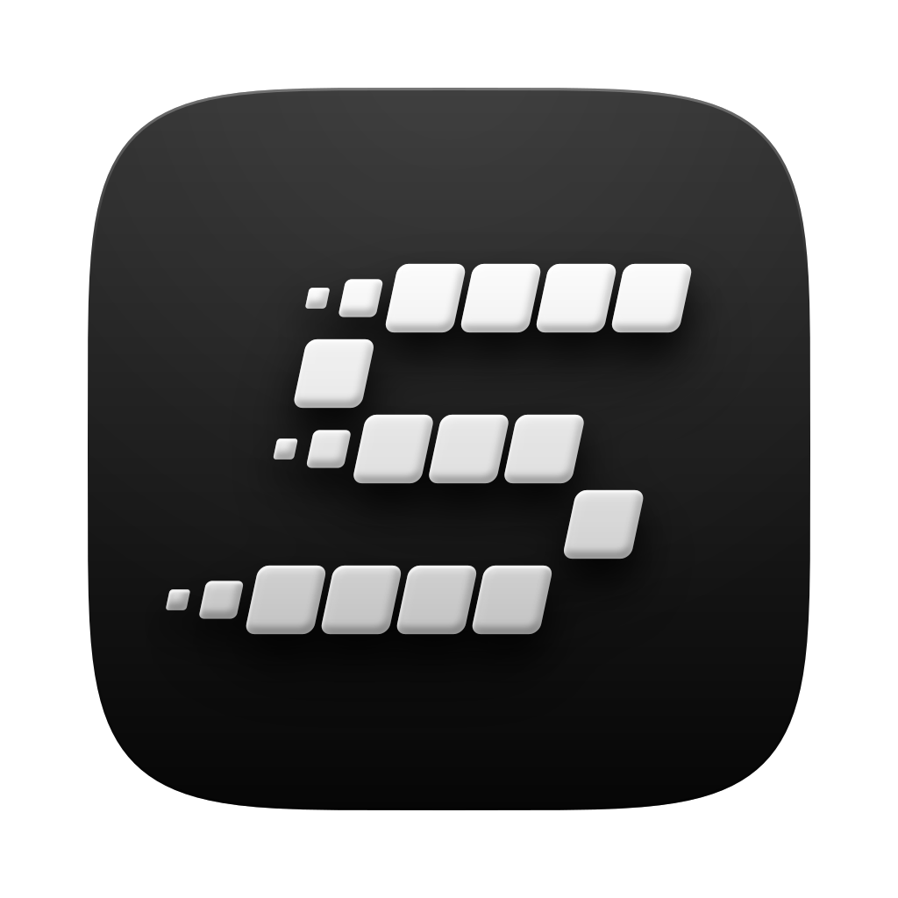

<p align="center">
  
</p>

# Spontaneous

A macOS app for recording UI and turning the recording into a product video. You record a web or mobile screen, leave notes on the frames, and your own Claude Code turns those notes into edits.

**Record → Annotate → Agent applies → Preview → Export**

It's in early development. The roadmap is in section 12 of [docs/ARCHITECTURE.md](docs/ARCHITECTURE.md#12-roadmap).

## How it works

- **Record raw, render later.** A recording is a set of timestamped tracks: screen video without the cursor, cursor images, clicks, keys and audio. Zooms, cursor smoothing, device frames and backgrounds are applied at render time from a small edit list, so you can change them at any point.
- **Notes are the main way to edit.** You draw, type or speak on a frame. The note is pinned to a moment and a region, and the agent turns it into edits that you can undo together.
- **The agent edits through typed tools.** The agent panel runs your own `claude` CLI on your plan login. It can only act through the app's MCP tools, such as `add_zoom` and `add_callout`, never through files or a shell.
- **Local first.** No account and no server. A project is a folder on disk.

## Requirements

- macOS 15 or later
- Xcode 26 or later, because the capture crate needs the macOS 26 SDK
- Node 26 via [nvm](https://github.com/nvm-sh/nvm). The version is pinned in `.nvmrc`
- Rust via rustup
- The [Claude Code](https://claude.com/claude-code) CLI, signed in, to use the agent panel

## Getting started

```bash
nvm use
npm install
npm run tauri:dev
```

This runs "Spontaneous Dev", which has its own bundle ID and reloads live. The first time you record, macOS asks for screen-recording permission.

## Commands

| Command | What it does |
|---|---|
| `npm run tauri:dev` | Runs the dev app with live reload |
| `npm run package` | Builds and signs the real app, then copies the DMG to `~/Builds/sptn.noindex/dmg` |
| `npm run typecheck` | Checks TypeScript. Run it before every commit |
| `npm version patch` | Bumps the version, tags it and pushes. GitHub then builds a draft release |
| `cargo test -p spontaneous --lib agent -- --include-ignored` | Agent host tests. Some call the real CLI and use a little plan usage |

[docs/COMMANDS.md](docs/COMMANDS.md) covers the full workflow, releases and fixes for common problems.

## Build output lives outside the repo

All build output goes to `~/Builds/sptn.noindex`, never into this folder. App cleaners match folders by the app's name and once trashed the whole project. `scripts/use-external-target.sh` points Cargo there before every `npm run tauri` command.

- Build installers only with `npm run package`. A plain `tauri build` skips the signing certificate, and the app loses its screen-recording permission on every build.
- Don't run an app cleaner or uninstaller on Spontaneous. To remove it, delete `/Applications/Spontaneous.app`. Your recordings are in `~/Movies/Spontaneous`.

## Repository layout

| Path | What's there |
|---|---|
| `src-tauri/` | The Tauri app: agent host, capture commands, project, tray and viewport |
| `crates/capture/` | ScreenCaptureKit recording, input tracks and the cursor atlas |
| `src/` | The React UI: `editor`, `recorder`, `picker` and the `ui` component library |
| `docs-site/` | The component docs site, served at `/docs.html` in dev |
| `docs/` | Architecture, decisions, agent design and checklists |
| `scripts/` | Packaging, versioning and build-folder setup |
| `brand/` | The app mark |

## Docs

- [ARCHITECTURE.md](docs/ARCHITECTURE.md): the engineering plan. Read it before structural work.
- [AGENT_HARNESS.md](docs/AGENT_HARNESS.md): what the agent sees and how its sessions run.
- [AGENT_UI.md](docs/AGENT_UI.md): which agent component shows for which moment.
- [DECISIONS.md](docs/DECISIONS.md): what's decided and what's still open.
- [SHOT_LIBRARY.md](docs/SHOT_LIBRARY.md): shots and camera moves.
- [CHECKLIST.md](docs/CHECKLIST.md): things built but not yet checked by hand.
- [COMMANDS.md](docs/COMMANDS.md): every command, for day-to-day use.
